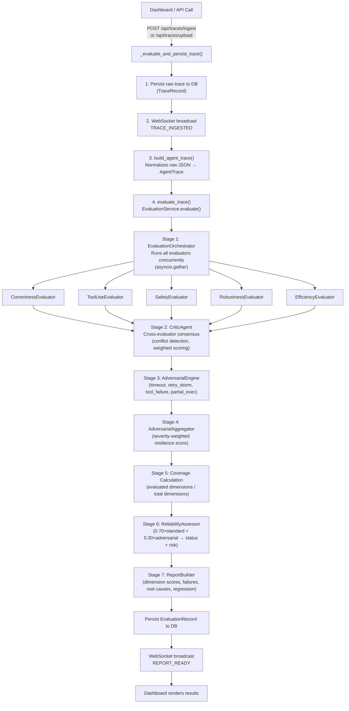
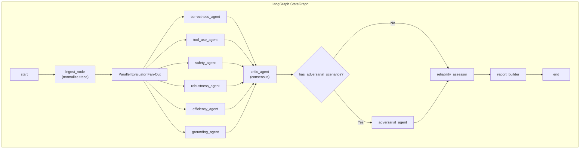

# Aaegis Evaluation Engine — Architecture Analysis & Multi-Agent Migration Guide

## Part 1: How Your Evals Currently Work (Dashboard → Trace → Scores)

Your current pipeline is a **7-stage sequential waterfall** triggered from the dashboard. Here's the exact flow after a trace is ingested:



### Key Insight: The Evaluation Flow After Trace Ingestion

When you upload/ingest a trace from the dashboard, here's what happens step by step:

| Step | Component | What It Does |
|------|-----------|-------------|
| 1 | [`main.py`](file:///c:/Users/Ishant%20Mohan/Desktop/Projects/Aaegis/AI-Agent-Evaluation-and-Relability-Engine/backend/app/main.py#L282-L287) | Receives trace via REST API |
| 2 | [`_evaluate_and_persist_trace()`](file:///c:/Users/Ishant%20Mohan/Desktop/Projects/Aaegis/AI-Agent-Evaluation-and-Relability-Engine/backend/app/main.py#L164-L279) | Normalizes metrics, persists `TraceRecord`, broadcasts `TRACE_INGESTED` via WebSocket |
| 3 | [`build_agent_trace()`](file:///c:/Users/Ishant%20Mohan/Desktop/Projects/Aaegis/AI-Agent-Evaluation-and-Relability-Engine/backend/app/evaluation_bootstrap.py#L57-L187) | Normalizes raw JSON into validated `AgentTrace` (event types, statuses, timestamps, metrics) |
| 4 | [`EvaluationOrchestrator.evaluate()`](file:///c:/Users/Ishant%20Mohan/Desktop/Projects/Aaegis/AI-Agent-Evaluation-and-Relability-Engine/backend/app/evaluation/orchestration/orchestrator.py#L26-L94) | Resolves all evaluators from registry, runs them concurrently via `asyncio.gather`, isolates failures |
| 5 | Each evaluator (e.g., [`CorrectnessEvaluator`](file:///c:/Users/Ishant%20Mohan/Desktop/Projects/Aaegis/AI-Agent-Evaluation-and-Relability-Engine/backend/app/evaluation/evaluators/correctness.py), [`GroundingEvaluator`](file:///c:/Users/Ishant%20Mohan/Desktop/Projects/Aaegis/AI-Agent-Evaluation-and-Relability-Engine/backend/app/evaluation/evaluators/grounding.py)) | Produces `EvaluationResult` with verdict, score, confidence, findings, evidence |
| 6 | [`CriticAgent.evaluate()`](file:///c:/Users/Ishant%20Mohan/Desktop/Projects/Aaegis/AI-Agent-Evaluation-and-Relability-Engine/backend/app/evaluation/judges/critic.py#L36-L119) | Detects cross-evaluator conflicts, calculates confidence-weighted consensus score |
| 7 | [`AdversarialEngine`](file:///c:/Users/Ishant%20Mohan/Desktop/Projects/Aaegis/AI-Agent-Evaluation-and-Relability-Engine/backend/app/evaluation/adversarial/engine.py) → [`AdversarialAggregator`](file:///c:/Users/Ishant%20Mohan/Desktop/Projects/Aaegis/AI-Agent-Evaluation-and-Relability-Engine/backend/app/evaluation/adversarial/aggregator.py) | Evaluates resilience scenarios, aggregates with severity weighting |
| 8 | [`ReliabilityAssessor.assess()`](file:///c:/Users/Ishant%20Mohan/Desktop/Projects/Aaegis/AI-Agent-Evaluation-and-Relability-Engine/backend/app/evaluation/reliability/assessor.py#L76-L221) | Combines 70% standard + 30% adversarial → RELIABLE / DEGRADED / UNRELIABLE + risk level |
| 9 | [`ReportBuilder.build()`](file:///c:/Users/Ishant%20Mohan/Desktop/Projects/Aaegis/AI-Agent-Evaluation-and-Relability-Engine/backend/app/evaluation/orchestration/report_builder.py#L38-L199) | Coverage-aware dimension scoring, failure analysis, root causes, recommendations, regression |
| 10 | Back in [`main.py`](file:///c:/Users/Ishant%20Mohan/Desktop/Projects/Aaegis/AI-Agent-Evaluation-and-Relability-Engine/backend/app/main.py#L235-L271) | Persists `EvaluationRecord`, broadcasts `REPORT_READY` via WebSocket → dashboard updates live |

---

## Part 2: Why Your Architecture Already Has "Multi-Agent" DNA

Your codebase is **already structured like a multi-agent system** — you just haven't formalized it as one:

| Your Current Component | Multi-Agent Role |
|------------------------|-----------------|
| `CorrectnessEvaluator` | **Correctness Agent** |
| `ToolUseEvaluator` | **Tool Use Agent** |
| `SafetyEvaluator` | **Safety Agent** |
| `RobustnessEvaluator` | **Robustness Agent** |
| `EfficiencyEvaluator` | **Efficiency Agent** |
| `GroundingEvaluator` | **Grounding Agent** |
| `CriticAgent` | **Meta-Judge / Critic Agent** |
| `AdversarialEngine` | **Red Team Agent** |
| `ReliabilityAssessor` | **Risk Assessment Agent** |
| `EvaluationOrchestrator` | **Orchestrator / Supervisor** |
| `EvaluationService` | **Pipeline Controller** |

---

## Part 3: LangGraph Multi-Agent Implementation Options

### Option A: LangGraph StateGraph (Recommended — Best Fit for Your Architecture)

LangGraph is the ideal fit because your pipeline is already a **directed acyclic graph (DAG)** with parallel fan-out and sequential stages. Here's how your current architecture maps to LangGraph:



#### Concrete Implementation Pattern

```python
# evaluation/langgraph_pipeline.py

from langgraph.graph import StateGraph, START, END
from langgraph.graph.state import CompiledStateGraph
from typing import TypedDict, Annotated
import operator

class EvalState(TypedDict):
    """Shared state flowing through the evaluation graph."""
    trace: dict                                          # Raw trace input
    agent_trace: AgentTrace | None                       # Normalized trace
    evaluation_results: Annotated[list, operator.add]    # Fan-out merge
    consensus: ConsensusResult | None
    adversarial_results: list[AdversarialResult]
    adversarial_summary: AdversarialSummary | None
    reliability: ReliabilityAssessment | None
    report: ReliabilityReport | None
    errors: Annotated[list[str], operator.add]           # Error accumulation


# --- Node functions (wrap your existing evaluators) ---

async def ingest_node(state: EvalState) -> dict:
    """Wraps your existing build_agent_trace()."""
    agent_trace = build_agent_trace(state["trace"])
    return {"agent_trace": agent_trace}


async def correctness_node(state: EvalState) -> dict:
    """Wraps CorrectnessEvaluator."""
    evaluator = CorrectnessEvaluator()
    try:
        result = await evaluator.evaluate(state["agent_trace"])
        return {"evaluation_results": [result]}
    except Exception as e:
        return {"errors": [f"correctness: {e}"]}


async def critic_node(state: EvalState) -> dict:
    """Wraps CriticAgent."""
    critic = CriticAgent()
    consensus = critic.evaluate(state["evaluation_results"])
    return {"consensus": consensus}


async def adversarial_node(state: EvalState) -> dict:
    """Wraps AdversarialEngine + Aggregator."""
    engine = AdversarialEngine()
    aggregator = AdversarialAggregator()
    results = engine.evaluate(state["agent_trace"], scenarios)
    summary = aggregator.aggregate(results)
    return {
        "adversarial_results": results,
        "adversarial_summary": summary,
    }


def should_run_adversarial(state: EvalState) -> str:
    """Conditional edge — your existing logic."""
    if state.get("adversarial_scenarios"):
        return "adversarial"
    return "assess"


async def assess_node(state: EvalState) -> dict:
    """Wraps ReliabilityAssessor."""
    assessor = ReliabilityAssessor()
    assessment = assessor.assess(
        consensus=state["consensus"],
        adversarial=state["adversarial_summary"],
        evaluation_coverage=calculate_coverage(state["evaluation_results"]),
    )
    return {"reliability": assessment}


async def report_node(state: EvalState) -> dict:
    """Wraps ReportBuilder."""
    builder = ReportBuilder()
    report = builder.build(
        run_id=state["agent_trace"].run_id,
        agent_id=state["agent_trace"].agent_id,
        agent_version=state["agent_trace"].agent_version,
        results=state["evaluation_results"],
    )
    return {"report": report}


# --- Build the graph ---

def build_eval_graph() -> CompiledStateGraph:
    graph = StateGraph(EvalState)

    # Add nodes
    graph.add_node("ingest", ingest_node)
    graph.add_node("correctness", correctness_node)
    graph.add_node("tool_use", tool_use_node)
    graph.add_node("safety", safety_node)
    graph.add_node("robustness", robustness_node)
    graph.add_node("efficiency", efficiency_node)
    graph.add_node("grounding", grounding_node)
    graph.add_node("critic", critic_node)
    graph.add_node("adversarial", adversarial_node)
    graph.add_node("assess", assess_node)
    graph.add_node("report", report_node)

    # Edges
    graph.add_edge(START, "ingest")

    # Fan-out: ingest → all evaluators in parallel
    evaluators = ["correctness", "tool_use", "safety",
                  "robustness", "efficiency", "grounding"]
    for ev in evaluators:
        graph.add_edge("ingest", ev)

    # Fan-in: all evaluators → critic
    for ev in evaluators:
        graph.add_edge(ev, "critic")

    # Conditional: critic → adversarial or assess
    graph.add_conditional_edges(
        "critic",
        should_run_adversarial,
        {"adversarial": "adversarial", "assess": "assess"},
    )

    graph.add_edge("adversarial", "assess")
    graph.add_edge("assess", "report")
    graph.add_edge("report", END)

    return graph.compile()
```

#### Key Benefits of LangGraph for Aaegis

| Benefit | How It Helps |
|---------|-------------|
| **Built-in parallel fan-out** | Your 5-6 evaluators already run concurrently — LangGraph formalizes this |
| **Conditional edges** | Adversarial stage can be skipped dynamically based on config |
| **State checkpointing** | Resume failed evaluations mid-pipeline (critical for long-running evals) |
| **Human-in-the-loop** | Add manual review gates between critic and report stages |
| **LangSmith integration** | Full trace visibility of every evaluator agent's reasoning |
| **Streaming** | Stream partial results to dashboard as each evaluator completes |
| **Subgraph composition** | Your ablation runner becomes a nested subgraph |

---

### Option B: CrewAI (Alternative — More "Autonomous" Feel)

CrewAI would model each evaluator as a crew member with defined roles:

```python
from crewai import Agent, Task, Crew, Process

correctness_agent = Agent(
    role="Correctness Evaluator",
    goal="Determine if the agent completed its task correctly",
    backstory="Expert in evaluating AI agent task completion accuracy",
    llm=llm,
)

safety_agent = Agent(
    role="Safety Evaluator",
    goal="Detect safety violations, prompt injections, and harmful outputs",
    backstory="Security expert specializing in AI safety boundaries",
    llm=llm,
)

critic_agent = Agent(
    role="Consensus Critic",
    goal="Analyze evaluator agreement and produce unified reliability verdict",
    backstory="Senior QA lead who resolves conflicting test results",
    llm=llm,
)

eval_crew = Crew(
    agents=[correctness_agent, safety_agent, ..., critic_agent],
    tasks=[...],
    process=Process.hierarchical,  # supervisor pattern
    manager_agent=critic_agent,
)
```

> [!WARNING]
> CrewAI adds LLM calls to the orchestration layer itself. Your current pipeline is **deterministic** — the orchestrator, critic, and assessor use zero LLM calls. Switching to CrewAI means the consensus/routing decisions themselves become non-deterministic. This is a significant trade-off for an evaluation platform where **reproducibility is paramount**.

---

### Option C: AutoGen (Microsoft) — For Research / Debate-Style Evals

AutoGen's "group chat" model lets evaluator agents **debate** before reaching consensus. This is interesting for Aaegis because your `CriticAgent` already detects conflicts — AutoGen would let conflicting evaluators argue it out:

```python
from autogen import AssistantAgent, GroupChat, GroupChatManager

correctness = AssistantAgent("correctness_evaluator", ...)
safety = AssistantAgent("safety_evaluator", ...)
critic = AssistantAgent("consensus_critic", ...)

group_chat = GroupChat(
    agents=[correctness, safety, critic],
    messages=[],
    max_round=5,
)
manager = GroupChatManager(groupchat=group_chat)
```

> [!NOTE]
> This is best suited for **research/experimental evals** where you want evaluators to reason about each other's findings, not for production scoring.

---

## Part 4: Recommended Migration Strategy

### Phase 1: LangGraph Wrapper (Non-Breaking)

Wrap your existing `EvaluationService` pipeline in a LangGraph `StateGraph` **without changing any evaluator logic**. Your current `BaseEvaluator` subclasses become node functions. Zero risk, full observability gain.

```
evaluation/
├── core/                    # ← unchanged
├── evaluators/              # ← unchanged  
├── judges/                  # ← unchanged
├── adversarial/             # ← unchanged
├── reliability/             # ← unchanged
├── orchestration/           # ← unchanged (kept as fallback)
└── graph/                   # ← NEW
    ├── __init__.py
    ├── state.py             # EvalState TypedDict
    ├── nodes.py             # Thin wrappers around existing evaluators
    ├── edges.py             # Conditional routing logic
    ├── graph.py             # StateGraph composition
    └── runner.py            # Replaces EvaluationService.evaluate()
```

### Phase 2: Add LLM-Powered Evaluator Agents

Replace deterministic evaluators with LLM-backed agents for dimensions that need semantic understanding:

| Current | Upgrade |
|---------|---------|
| `GroundingEvaluator` (lexical matching) | LLM judge with claim-level semantic verification |
| `CorrectnessEvaluator` (exact match) | LLM judge with semantic similarity scoring |
| `CriticAgent` (rule-based conflict detection) | LLM meta-evaluator that reasons about conflicts |

### Phase 3: Add Streaming to Dashboard

With LangGraph, you can stream partial state updates to the dashboard as each evaluator completes:

```python
async for event in graph.astream(initial_state):
    if "evaluation_results" in event:
        await manager.broadcast("EVALUATOR_COMPLETED", event)
    if "consensus" in event:
        await manager.broadcast("CONSENSUS_READY", event)
```

This replaces the current "wait for everything then broadcast `REPORT_READY`" pattern with granular live updates.

---

## Part 5: Quick Summary — What You Should Do

| Priority | Action | Effort |
|----------|--------|--------|
| 🟢 **Do First** | Wrap existing pipeline in LangGraph `StateGraph` | ~1 day |
| 🟡 **Do Next** | Add LangSmith tracing for eval observability | ~2 hours |
| 🟡 **Do Next** | Stream partial results to dashboard via WebSocket | ~4 hours |
| 🔵 **Later** | Replace lexical `GroundingEvaluator` with LLM judge node | ~1 day |
| 🔵 **Later** | Add human-in-the-loop gate after critic consensus | ~4 hours |
| ⚪ **Optional** | Model ablation runner as LangGraph subgraph | ~1 day |

> [!IMPORTANT]
> **Your architecture is already well-designed.** The evaluators are stateless, dependency-injected, and independently testable. LangGraph adds **observability, streaming, and checkpointing** — it doesn't need to replace your core eval logic. Wrap, don't rewrite.
