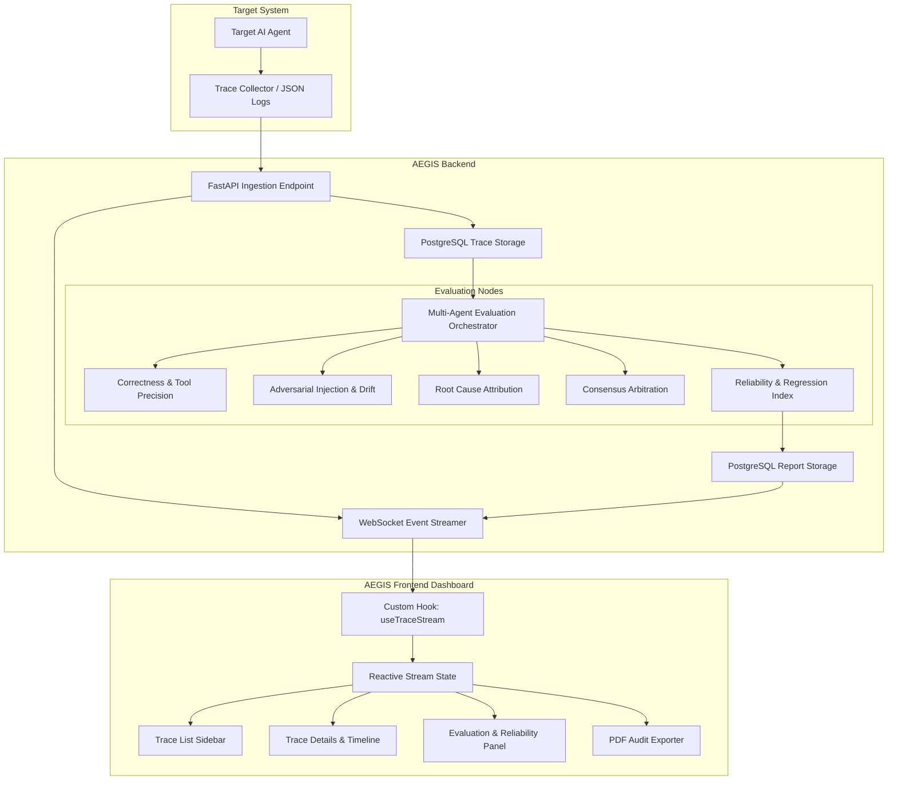

# AEGIS Architecture & Codebase Organization

## 1. Overview
The AEGIS Platform is a multi-agent evaluation, reliability, and observability engine for autonomous AI systems. It decouples execution trace collection, multi-dimensional evaluators, consensus arbitration, adversarial test-case generation, and real-time dashboard visualization.



---

## 2. Clean Directory Structure

```
├── .env.example                       # Root environment template
├── contracts/                         # Language-agnostic JSON schemas
│   ├── evaluation.schema.json
│   ├── report.schema.json
│   └── trace.schema.json
├── backend/
│   ├── .env.example                   # Backend environment configuration template
│   ├── test_hybrid_orchestrator.py    # Multi-agent state machine verification runner
│   ├── app/
│   │   ├── main.py                    # Scalable FastAPI entrypoint & middleware
│   │   ├── database.py                # SQLAlchemy engine & session factory
│   │   ├── models.py                  # Database ORM models (TraceRecord, EvaluationRecord)
│   │   ├── evaluation_bootstrap.py    # Bridge to the evaluation engine
│   │   ├── core/                      # Global core configuration & error handling
│   │   │   ├── config.py              # Pydantic BaseSettings with typed validation
│   │   │   ├── errors.py              # Custom exceptions & global handlers
│   │   │   └── ws_manager.py          # WebSocket client broadcast manager
│   │   ├── api/                       # Versioned REST and WebSocket routes
│   │   │   └── v1/
│   │   │       ├── endpoints/
│   │   │       │   ├── traces.py      # /api/traces (list, ingest, upload)
│   │   │       │   ├── evaluations.py # /api/evaluations (list, detail)
│   │   │       │   ├── scenarios.py   # /api/scenarios (adversarial generator)
│   │   │       │   └── ws.py          # /ws/traces (real-time stream)
│   │   │       └── __init__.py        # Consolidated v1 router
│   │   ├── schemas/                   # Pydantic v2 validation contracts
│   │   │   └── trace.py
│   │   ├── services/                  # Business logic decoupled from HTTP handlers
│   │   │   ├── trace_service.py       # Persistence, normalization, and evaluation execution
│   │   │   └── scenario_service.py    # Adversarial probe and test scenario synthesis
│   │   ├── evaluation/                # Evaluator agents, judges, and consensus engine
│   │   ├── orchestration/             # CrewAI + LangGraph multi-agent coordination
│   │   └── tracing/                   # Agent trace collector & metrics builder
│   └── tests/                         # Pytest test suites (Unit, Integration, Adversarial)
├── frontend/
│   ├── .env.local.example             # Frontend environment template
│   ├── app/
│   │   ├── layout.tsx                 # Root layout & font definition
│   │   ├── page.tsx                   # Clean dashboard view container
│   │   └── EvaluationPanel.tsx        # Evaluator findings & regression badges
│   └── src/
│       ├── types/                     # Central TypeScript data contracts & interfaces
│       ├── services/
│       │   └── api.ts                 # Type-safe API client (fetch & file uploads)
│       ├── hooks/
│       │   └── useTraceStream.ts      # Custom state hook for WebSocket & trace cache
│       ├── components/                # Modular presentational UI components
│       │   ├── Header.tsx             # Navbar with upload, refresh & scenario triggers
│       │   ├── TraceList.tsx          # Sidebar list with score badges
│       │   ├── TraceDetails.tsx       # Metrics, prompt, output & event timeline
│       │   └── ScenarioGeneratorModal.tsx # Adversarial scenario generator modal
│       └── utils/
│           └── pdfExport.ts           # Clean jsPDF audit report generation
└── docs/                              # Architecture, methodology & API docs
```

---

## 3. Separation of Concerns
- **Business Logic vs. UI**: The frontend pages and UI components only render data and dispatch user actions. Data fetching, error handling, file parsing, and WebSocket reconnection are encapsulated inside `services/api.ts` and `hooks/useTraceStream.ts`.
- **API Routers vs. Services**: The backend API endpoints in `app/api/v1/endpoints/` handle HTTP status codes, query parsing, and serialization. Database transactions and evaluation pipeline execution live in `app/services/trace_service.py` and `app/services/scenario_service.py`.
- **Configuration**: All credentials, database connection strings, and model parameters are strictly loaded through `pydantic_settings.BaseSettings` in `app/core/config.py` from `.env` files without hardcoded strings in application logic.
- **Error Handling**: Global exception handlers in `app/core/errors.py` intercept domain exceptions and unhandled server errors, returning consistent, typed JSON responses to prevent leaking internal traces.
